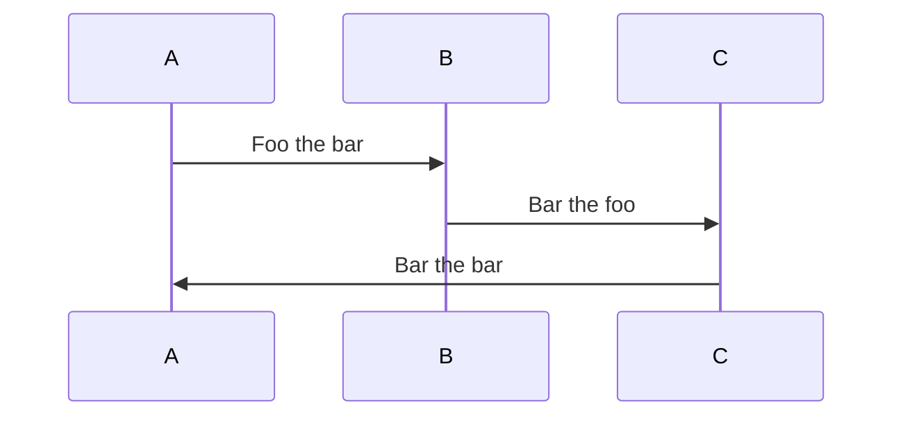

# Design Doc

This is a document that outlines the initial design for the service, including
its scope and its intended integrations.

## Motivation

Motivation on why this service will be built.

## Name

State the name of the service and a sentence on why that name was selected.

## Scope

This section should state how the service works as bullet points.

## Overview

Overview of different apps the service will consist and how they interact.

## Integrations

This section should outline what other systems this service should communicate
with. It should state how authentication is handled.

## System Infrastructure

This section should mention any major choices of technology that are not already
in
[cirrus-service-template](https://github.com/cirruscrmio/cirrus-service-template).

## Security

A note on security matters, such as

- Authentication/authorization if used
- How are secrets handled and how they are rotated
- Public vs private endpoints

## Observability

Mention any observability notes outside what is already done in the service
template.

## Implementation details

State the expected API contract if applicable and draft of domain entities and
ports.
